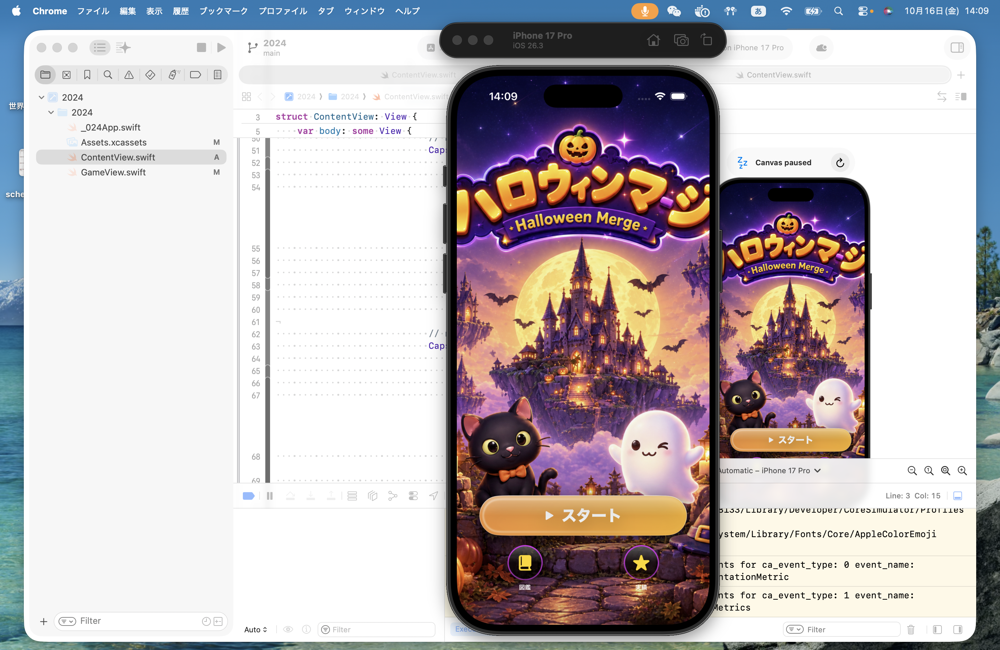

# 日専祭アプリ：ハロウィンマージ

> **チーム：**
> 「猫のクボ太」
>
> **氏名：**
> 26CM0112 伍夢露、メンパー名：26CM0110 窪田 黄菜子（リーダー） 26CM0111 黒田　貴子
> 
> **AI利用レベル：** 2
> 
> **最終更新：** 2026−11−09

> 💡 制作の進め方は担任の先生から案内があります。このファイルの項目は、担任の先生の指示で増えることがあります。

---

## 何ができるアプリか（3行）
パスルゲーム２０４８のマージゲーム。
マス目上でタイルをスライドさせて同じアイテムを重ねる合体します。
ハロウィンの世界の中で遊べます。

## 画面
 

## 使った文法・技術
`@State`、`.navigationDestination`、`ForEach`

## 生成AIの使い方（どの場面で、どう使ったか）
画面の骨組みは ChatGPT に書いてもらった。
ゲームのキャラクターはAIによって生成された画像だ。
音楽の切り替え機能について、多くのビューやさまざまなゲームモードがあり、BGMを柔軟に切り替える必要があるため、AIにどのようにすればスムーズに動作させられるか尋ねた。

## 展示で工夫した点
起動画面の「開始」ボタンには、プレイヤーの探求心をくすぐるよう、意図的に呼吸のようなリズムの効果を施しました。また、ハロウィーンをテーマにしたゲーム説明アニメーションを追加し、視覚的な楽しみを盛り込んでいます。ニックネームでのログイン時、悪意のある行為を防ぐため、意図的に設定された不適切な言葉の警告機能により、マナーを守ったゲームプレイを推奨しています。
